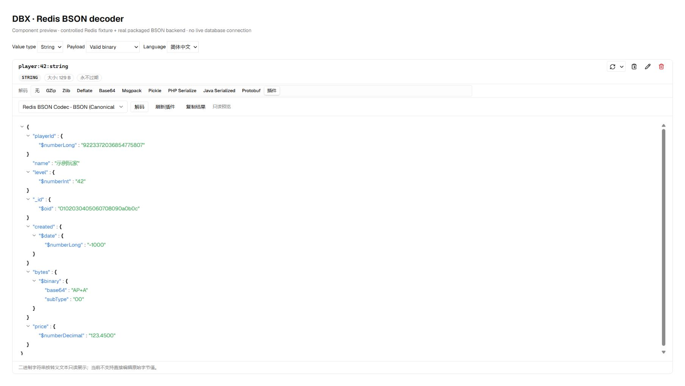
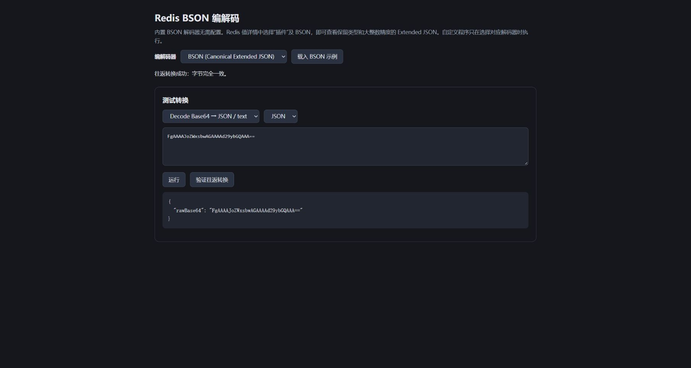

# Redis BSON Codec for DBX

Decode Redis BSON bytes directly in DBX's existing value viewer. The bundled converter requires no MongoDB server, Node.js, Python, or executable-path configuration. An optional custom external-program codec retains the original configurable conversion workflow.

**Initial release target: Windows x64.** This is an unsigned review candidate until DBX Store approves and signs it. The plugin uses the host `redis-value-codec-v1` extension merged in [DBX #13154](https://github.com/t8y2/dbx/pull/13154); the extension is confirmed present in DBX v0.6.55 source and later releases. Installation on older hosts does not add the Redis decoder UI.

## Use in Redis

1. Install the repository-signed package from Plugin Center after store approval. For local development, explicitly enable unsigned development installs and import the candidate `.dbxp`.
2. Open a Redis String value or a collection member's full-value detail.
3. In the **Decode** row choose **Plugin**, then **Redis BSON Codec · BSON (Canonical Extended JSON)**.
4. Read or copy the decoded JSON tree. Choose a built-in decoder to return to the original bytes.

Redis previews are read-only. This plugin never connects to Redis or writes decoded edits back to it. The workbench can separately encode Extended JSON into BSON and compare a decode/encode round trip.



The screenshot mounts the actual Redis viewer with a controlled BSON fixture and the packaged native backend; it is not evidence of a live Redis connection.

## Type preservation

The converter uses the official MongoDB Go Driver v2.7.0 and [Canonical Extended JSON](https://www.mongodb.com/docs/drivers/go/current/data-formats/extended-json/). For example:

```json
{
  "playerId": {"$numberLong": "9223372036854775807"},
  "_id": {"$oid": "0102030405060708090a0b0c"},
  "price": {"$numberDecimal": "123.4500"},
  "created": {"$date": {"$numberLong": "-1000"}},
  "bytes": {"$binary": {"base64": "AP+A", "subType": "00"}}
}
```

Int64 values remain exact strings inside `$numberLong`, rather than passing through JavaScript floating-point numbers. Dates, ObjectId, binary subtypes, Decimal128, Int32, timestamps, regular expressions and nested documents/arrays preserve their BSON type annotations. JavaScript/code-with-scope fields are displayed as data; code is never evaluated.

Input must be **one complete BSON document**, without compression, length prefixes beyond BSON's own header, or concatenated documents. Empty BSON documents work. A bare BSON scalar needs its original document wrapper. Duplicate field names, invalid UTF-8, malformed array indexes and nesting of 100 or more document levels are rejected rather than silently flattened in the host JSON viewer.

Raw input and serialized decoded output are each limited to 2 MiB. The converter runs in a separate process with a 3-second timeout; the parent caps stdout at 2 MiB and stderr at 16 KiB, bounds concurrency to four calls, and terminates timed-out process trees. Base64 expansion means some binary documents below 2 MiB still exceed the JSON output limit.

Canonical Extended JSON aims to preserve types, but byte-for-byte identity for every possible BSON encoding is not promised (for example unusual floating-point encodings or reserved Extended JSON field shapes). **Verify round trip** reports the actual byte comparison for the supplied sample.

## Workbench

Open **BSON Codec Workbench** in Plugin Center. BSON is selected by default. Click **Load BSON sample**, then **Run** or **Verify round trip**. The sample is the BSON document `{"hello":"world"}`:



```text
FgAAAAJoZWxsbwAGAAAAd29ybGQAAA==
```

For encoding, select **Encode JSON / text → Base64**, choose JSON, and paste a JSON or Extended JSON document. The result is Base64 of BSON bytes; it is not saved to Redis.

### Optional custom programs

Select **Custom external program** to reveal configuration. Programs must be absolute executable paths; arguments are arrays and are never passed through a shell. The decoder reads raw bytes from stdin and emits one JSON value or UTF-8 text. The encoder reads JSON/text from stdin and emits raw bytes. Diagnostics belong on stderr.

```json
{
  "decode": {"program": "C:\\Program Files\\nodejs\\node.exe", "args": ["C:\\codecs\\xor-json.mjs", "decode"]},
  "encode": {"program": "C:\\Program Files\\nodejs\\node.exe", "args": ["C:\\codecs\\xor-json.mjs", "encode"]},
  "format": "json",
  "timeoutMs": 3000
}
```

Replace these example paths with real local paths. `examples/xor-json.mjs` is a test converter, not encryption. Python or other executables can be configured the same way. Optional `directory` sets an absolute working directory. Timeout range: 100–8000 ms. The BSON codec ignores this configuration, so configuring a custom program never changes built-in BSON decoding.

## Permissions and privacy

Manifest permissions are empty. The workbench uses only its own sidecar bridge. The plugin does not request DBX credentials, connection configuration, host storage, clipboard or network APIs. BSON conversion has no network access in its implementation and opens no listening ports. It reads the current value passed by DBX; no telemetry is collected.

The native sidecar runs with the OS user's privileges, not inside an OS sandbox. Its BSON subprocess is the same executable with `--bson-decode` / `--bson-encode`, communicating through stdin/stdout. Custom programs, when explicitly selected, inherit the user's privileges and environment and may access files or the network according to their own behavior. Configure trusted programs only. Configuration is saved under DBX's `DBX_PLUGIN_DATA_DIR/config.json`.

## Build and verify

Go 1.26.5, PowerShell 7 and Node.js 22+ are used for release builds. No C compiler is required. Dependency versions and checksums are pinned in `go.mod` / `go.sum`.

```powershell
go test ./...
go vet ./...
./build.ps1
./scripts/verify-package.ps1 -Package (Get-ChildItem dist/*.dbxp).FullName -ExtractDirectory work/verified
node scripts/smoke.mjs "$PWD/work/verified/bin/windows-x64/backend.exe"
node scripts/release-metadata.mjs
```

The smoke test invokes the executable extracted from the package and verifies initialization, configuration-free BSON decoding, exact Int64 / ObjectId / Decimal128 / binary / date handling, known BSON wire bytes, reverse encoding, malformed input, custom external commands and persistent configuration.

The backend can also be used as a standalone binary filter without `DBX_PLUGIN_DATA_DIR`:

```text
backend.exe --bson-decode   # raw BSON stdin → Canonical Extended JSON stdout
backend.exe --bson-encode   # Extended JSON stdin → raw BSON stdout
```

Use byte-preserving pipes or process APIs; Windows PowerShell text redirection can change binary bytes.

## Official store submission

Source and unsigned release candidates belong in this repository. Store submissions add `publishers/chow-code.json` and `candidates/io.github.chow-code.redis-bson-codec.json` in a single PR to [t8y2/dbx-store](https://github.com/t8y2/dbx-store/blob/main/CONTRIBUTING.md). Store maintainers review, sign and publish approved packages; authors do not possess the official signing key. A submission PR's candidate-signing check stays red until this signing step is complete.

## 中文使用说明

本插件可以在 DBX 原有 Redis 值详情里直接反序列化 BSON，无需安装 MongoDB、Node.js 或 Python。选择“解码 → 插件 → BSON”即可查看 JSON 树。Int64、日期、ObjectId、Decimal128、二进制等采用 MongoDB 标准 Extended JSON 表示，避免精度和类型信息丢失。

当前候选包仅支持 Windows x64；需要包含 Redis 插件解码接口的 DBX，已确认 v0.6.55 源码具备该接口。工作台默认使用内置 BSON，可载入示例、编码和验证往返；自定义外部程序仍然可选。Redis 中的展示是只读预览，不会写回数据库。

输入必须是完整的单个 BSON 文档，不自动解压，也不解析多个 BSON 文档拼接。超过 2 MiB、截断、格式错误、重复字段或过深嵌套将报错。上架前由 DBX Store 官方审核和签名；未签名包仅用于明确开启开发安装的本地验证。

Apache-2.0. Third-party licenses and notices are shipped with the package.
